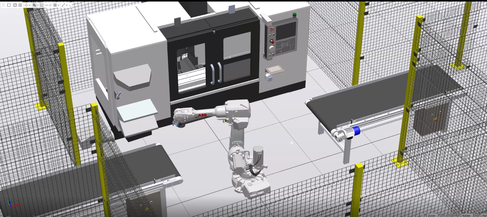
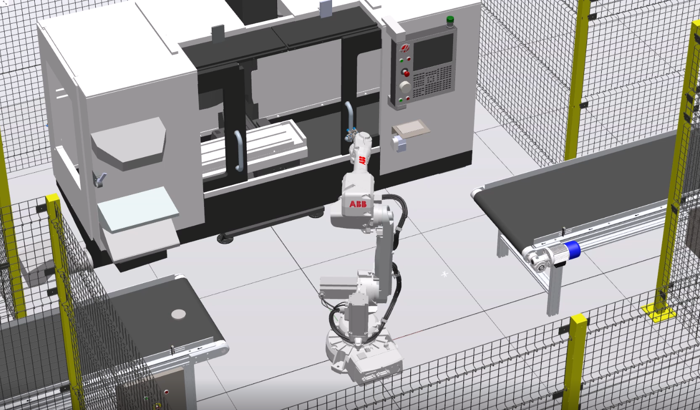
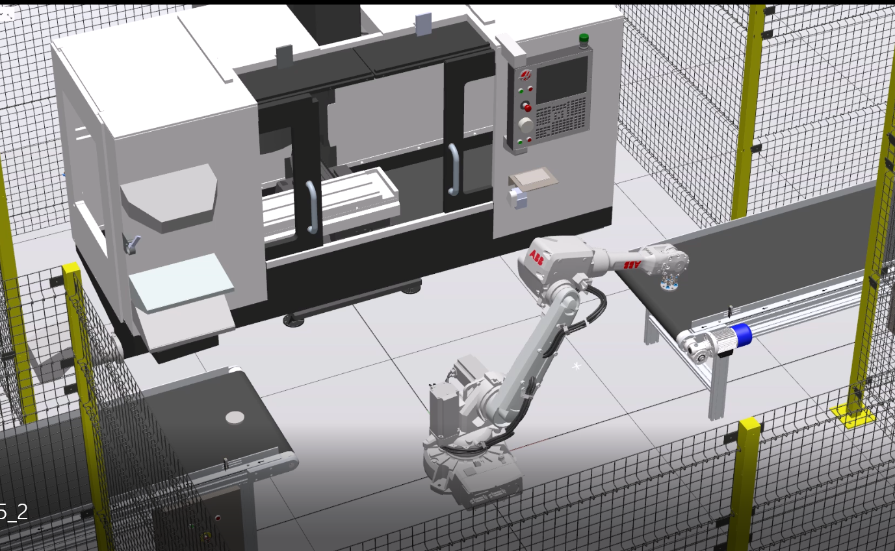
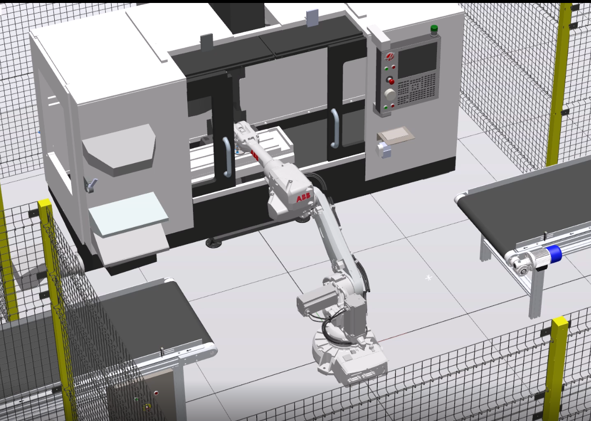
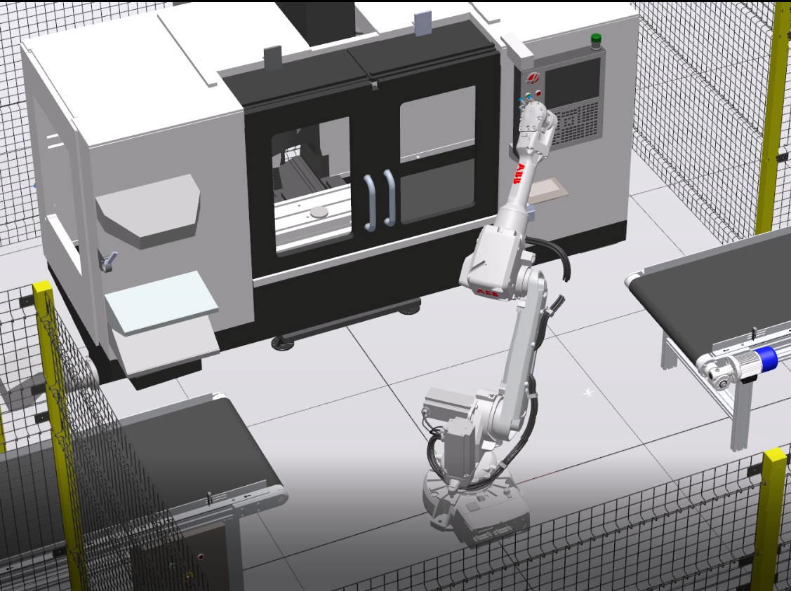
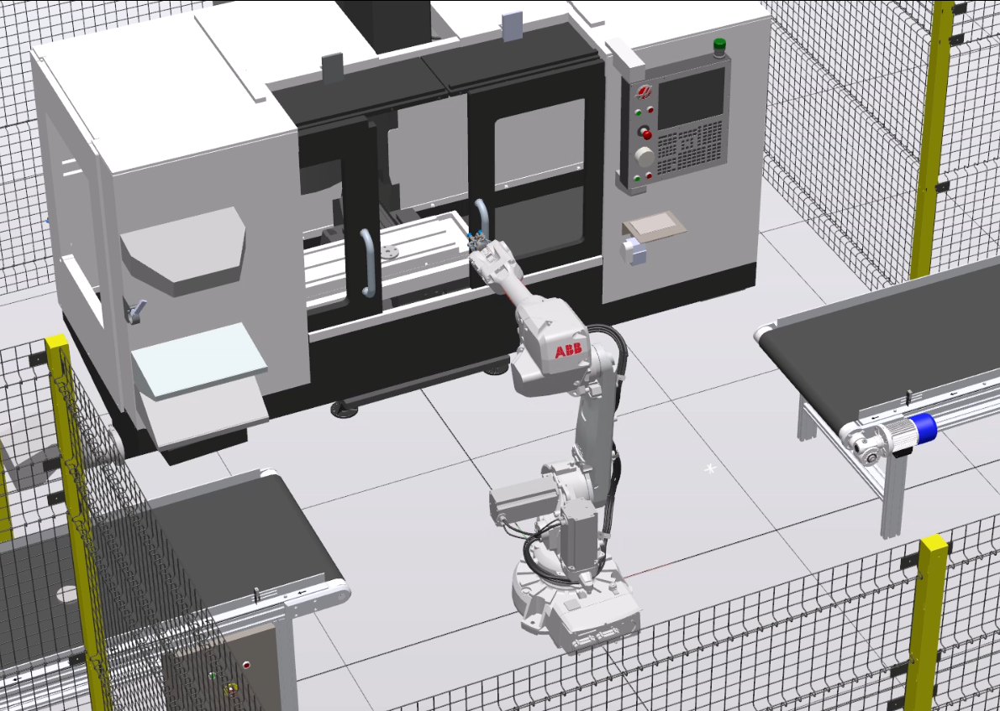

# Robot CNC Machine Tending – ABB IRB 2600 w RobotStudio

Symulacja zrobotyzowanego stanowiska obsługi obrabiarki CNC w środowisku **ABB RobotStudio**. Robot samodzielnie pobiera detal z przenośnika, otwiera i zamyka drzwi obrabiarki, ładuje detal na stół maszyny, uruchamia obróbkę przyciskiem na panelu, a po jej zakończeniu wyjmuje gotowy element i odkłada go na drugi przenośnik. Cykl działa w pętli.

Projekt został wykonany w **zespole dwuosobowym**.



---

## Spis treści

- [Opis projektu](#opis-projektu)
- [Użyte technologie](#użyte-technologie)
- [Przebieg cyklu](#przebieg-cyklu)
- [Działanie w symulacji](#działanie-w-symulacji)
- [Program robota (RAPID)](#program-robota-rapid)
- [Sygnały I/O](#sygnały-io)
- [Logika stacji (Smart Components)](#logika-stacji-smart-components)
- [Zdefiniowane punkty](#zdefiniowane-punkty)
- [Uruchomienie](#uruchomienie)


---



## Opis projektu

Stanowisko składa się z:

- robota **ABB IRB 2600-12/1.65 Type C** z chwytakiem (narzędzie `MyNewTool`),
- obrabiarki CNC z drzwiami otwieranymi i zamykanymi przez robota oraz panelem z przyciskami Start i Unlock,
- dwóch przenośników taśmowych: wejściowego (dostarcza surowy detal) i wyjściowego (odbiera obrobiony detal),
- ogrodzenia ochronnego.

Detal jedzie po taśmie do pola z czujnikiem. Gdy wjedzie na czujnik, taśma zatrzymuje się, a robot rozpoczyna sekwencję ruchów. Cała logika zachowania detalu w symulacji (pojawianie się, kolejka, przyczepianie do chwytaka, zamiana na element obrobiony) jest zrealizowana komponentami inteligentnymi (Smart Components) i sterowana sygnałami z programu robota.



## Użyte technologie

| Element | Wersja / model |
|---|---|
| Środowisko symulacyjne | ABB RobotStudio |
| Robot | ABB IRB 2600-12/1.65 Type C |
| Oprogramowanie sterownika | RobotWare 6.16.03 (wirtualny kontroler IRC5) |
| Język programowania robota | RAPID |
| Logika symulacji | Smart Components, Station Logic |

## Przebieg cyklu

1. **Start:** robot jedzie do pozycji domowej (`pHome`), zeruje sygnały i otwiera drzwi obrabiarki.
2. **Oczekiwanie:** program czeka na sygnał czujnika `di_klocek`, który oznacza, że detal dojechał do końca przenośnika wejściowego.
3. **Pobranie detalu:** robot zjeżdża do punktu `pPick`, chwyta detal (`doGripPuck`) i wysyła impuls `do_klocek_pobrany`, który zdejmuje detal z kolejki na taśmie.
4. **Załadunek do CNC:** robot wjeżdża do obrabiarki, odkłada detal na stół (`pCncChuck`) i wycofuje się.
5. **Zamknięcie drzwi:** robot zamyka lewe i prawe drzwi obrabiarki.
6. **Obróbka:** robot naciska przycisk startu na panelu (`pBtnStart`), a sygnał `doMachining` symuluje obróbkę przez 3 s (zamiana surowego detalu na obrobiony).
7. **Odblokowanie:** robot naciska przycisk na panelu (`pBtnUnlock`) i ponownie otwiera drzwi.
8. **Wyjęcie detalu:** robot chwyta obrobiony element i wynosi go z maszyny.
9. **Odłożenie:** robot odkłada element na drugi przenośnik (`pDrop`), wysyła impuls `do_odloz_klocek` i wraca do pozycji domowej.
10. **Pętla:** cykl wraca do kroku 2.

## Działanie w symulacji

Poniższe zrzuty ekranu pokazują kolejne etapy pracy robota przy obrabiarce.

**Załadunek i rozładunek:** robot wjeżdża do wnętrza obrabiarki przy otwartych drzwiach i odkłada detal na stół albo wyjmuje obrobiony element.



**Uruchomienie obróbki:** po zamknięciu drzwi robot naciska przycisk na panelu obrabiarki. W oknie maszyny widać detal leżący na stole.



**Obróbka i praca przy stole:** robot pracuje przy stole obrabiarki. Zmiana wyglądu detalu po obróbce jest realizowana przez Smart Components po sygnale `doMachining`.



## Program robota (RAPID)

Program znajduje się w `src/rapid/Module1.mod` i składa się z trzech procedur:

| Procedura | Zadanie |
|---|---|
| `OpenDoors` | otwiera lewe, a następnie prawe drzwi obrabiarki |
| `CloseDoors` | zamyka lewe, a następnie prawe drzwi |
| `main` | inicjalizacja i nieskończona pętla `WHILE TRUE` z pełnym cyklem |

Fragment pętli głównej:

```
WHILE TRUE DO
    ! 1. Oczekiwanie na czujnik
    WaitDI di_klocek, 1;

    ! 2. Pobranie z przenosnika
    MoveJ pPickApp, v1000, z50, MyNewTool;
    MoveL pPick, v200, fine, MyNewTool;
    SetDO doGripPuck, 1;

    ! Impuls do Smart Componentu
    SetDO do_klocek_pobrany, 1;
    WaitTime 0.5;
    SetDO do_klocek_pobrany, 0;
    ...
ENDWHILE
```

Najważniejsze rozwiązania:

- **Dojazdy z odsunięciem:** przed każdym zbliżeniem do detalu lub drzwi robot jedzie do punktu pośredniego (`...App` lub `RelTool(..., 0, 0, -100)`), a dopiero potem wolno zbliża się do celu ruchem liniowym.
- **Różne prędkości:** szybkie ruchy `MoveJ` (`v1000`) w przestrzeni swobodnej, wolne `MoveL` (`v200`, `v100`) przy chwytaniu i naciskaniu przycisków.
- **Drzwi:** robot chwyta każde skrzydło drzwi (`doGripDoorL`, `doGripDoorR`), pociąga je do pozycji otwartej lub zamkniętej i puszcza. Podczas przesuwu drzwi wyłączana jest kontrola konfiguracji osi (`ConfL \Off`).
- **Sygnały impulsowe:** sygnały `do_klocek_pobrany` i `do_odloz_klocek` są podawane krótkim impulsem i od razu zerowane, bo Smart Component reaguje na zbocze narastające.
- **Narzędzie:** dane chwytaka (`MyNewTool`) są w osobnym module `CalibData.mod`. Środek narzędzia (TCP) przesunięty jest o 89 mm w osi Z.

## Sygnały I/O

| Sygnał | Typ | Znaczenie |
|---|---|---|
| `di_klocek` | wejście | czujnik: detal dojechał do końca przenośnika wejściowego |
| `doGripPuck` | wyjście | chwytak: chwyć / puść detal |
| `doGripDoorL` | wyjście | chwytak: chwyć / puść lewe skrzydło drzwi |
| `doGripDoorR` | wyjście | chwytak: chwyć / puść prawe skrzydło drzwi |
| `doMachining` | wyjście | symulacja obróbki w CNC (zamiana modeli detalu) |
| `do_klocek_pobrany` | wyjście | impuls: detal pobrany z taśmy, zdejmij go z kolejki |
| `do_odloz_klocek` | wyjście | impuls: odłóż detal na przenośnik, przywróć fizykę |

Definicje sygnałów są w pliku `src/rapid/EIO.cfg`.

## Logika stacji (Smart Components)

Zachowanie detalu w symulacji realizują komponenty z biblioteki RobotStudio, połączone w logice stacji sygnałami:

| Komponent | Zadanie w projekcie |
|---|---|
| `PlaneSensor` / `VolumeSensor` | wykrywanie detalu na końcu taśmy i w strefie odbioru |
| `Source` | tworzy nowy detal na przenośniku wejściowym |
| `Queue` | kolejka detali na taśmie (dodawanie i zdejmowanie) |
| `LogicGate` | bramki logiczne łączące sygnały czujników i timerów |
| `Timer` | odstęp czasowy między kolejnymi detalami |
| `LinearMover` / `PhysicsControl` | ruch taśmy i włączanie fizyki powierzchni |
| `Attacher` / `Detacher` | przyczepienie detalu do chwytaka i odczepienie po odłożeniu |
| `Sink` + `Source` | zamiana surowego detalu na obrobiony po sygnale `doMachining` |

Zasada działania:

- czujnik na końcu taśmy zatrzymuje przenośnik i ustawia sygnał `di_klocek` dla robota,
- `do_klocek_pobrany` przyczepia detal do chwytaka i zdejmuje go z kolejki,
- `doGripPuck` przyczepia obrobiony element do chwytaka przy wyjmowaniu z maszyny,
- `doMachining` usuwa surowy detal i tworzy obrobiony,
- `do_odloz_klocek` odczepia detal od chwytaka na drugim przenośniku.

## Zdefiniowane punkty

W programie zdefiniowano 20 punktów (`robtarget`):

| Grupa | Punkty |
|---|---|
| Pozycja domowa | `pHome` |
| Przenośnik wejściowy | `pPickApp`, `pPick` |
| Obrabiarka | `pCncApp`, `pCncChuckApp`, `pCncChuck` |
| Drzwi lewe | `pDoorL_Closed`, `pDoorL_Opening`, `pDoorL_Open`, `pDoorL_Closing` |
| Drzwi prawe | `pDoorR_Closed`, `pDoorR_Opening`, `pDoorR_Open`, `pDoorR_Closing` |
| Panel obrabiarki | `pPanelApp`, `pBtnStart`, `pBtnUnlock` |
| Przenośnik wyjściowy | `pDropApp`, `pDrop` |

## Uruchomienie

Wymagany jest **ABB RobotStudio** z RobotWare w wersji 6.16.

1. Pobierz paczkę stacji `Projekt_Robot_CNC.rspag` z zakładki **Releases** tego repozytorium.
2. W RobotStudio wybierz **File → Open → Unpack & Work** i wskaż pobrany plik.
3. Poczekaj na odtworzenie stacji i wirtualnego kontrolera.
4. Na karcie **Simulation** kliknij **Play**.
5. Robot rozpocznie pracę od otwarcia drzwi i będzie czekał na detal na przenośniku.


